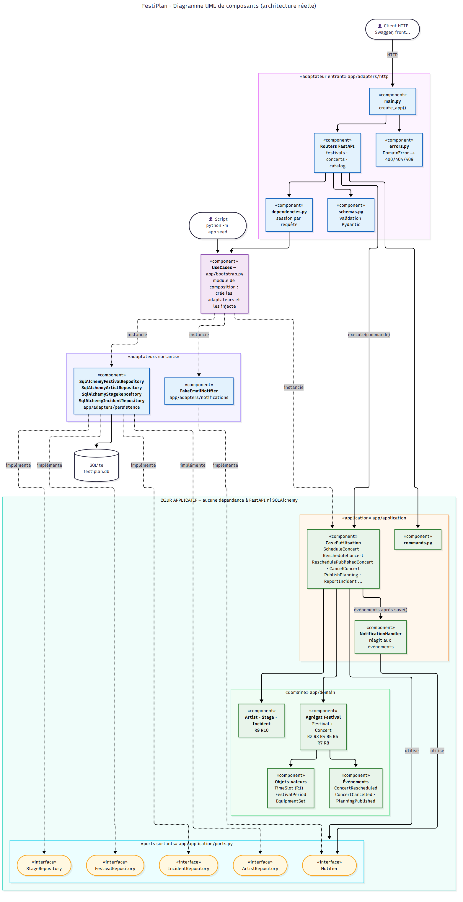
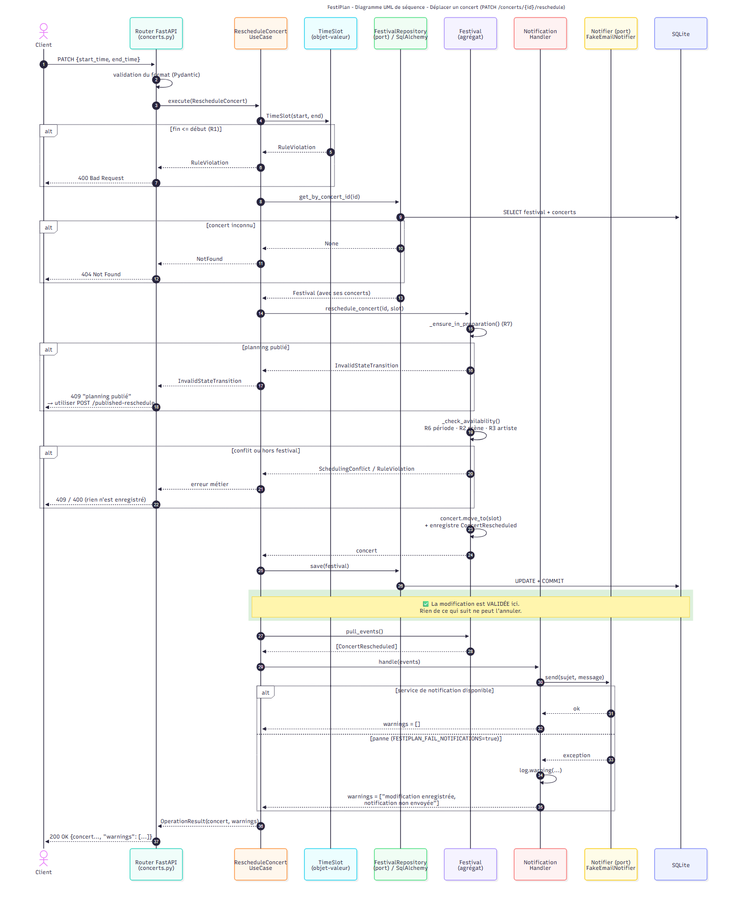

# FestiPlan — version refactorisée (architecture hexagonale + DDD)

API FastAPI de gestion d'un festival metal fictif : festivals, scènes, artistes, programmation des concerts,
publication du planning, incidents et notifications simulées.

Le projet initial a été refactorisé : le cœur métier (domaine + cas d'utilisation) ne dépend plus ni de
FastAPI ni de SQLAlchemy, les règles métier R1 à R10 sont centralisées et testées, et les trois défauts
initiaux sont corrigés et couverts par des tests de non-régression.

## Installation (Python 3.11+)

```bash
python -m venv .venv
# Windows PowerShell : .venv\Scripts\Activate.ps1
# macOS / Linux     : source .venv/bin/activate
pip install -r requirements.txt
```

Copier `.env.example` vers `.env` si besoin de changer la configuration :

| Variable | Défaut | Rôle |
|---|---|---|
| `FESTIPLAN_DATABASE_URL` | `sqlite:///./festiplan.db` | Base de données |
| `FESTIPLAN_FAIL_NOTIFICATIONS` | `false` | `true` simule une panne du service de notification |

## Initialisation des données

```bash
python -m app.seed
```

⚠️ Supprime et recrée toutes les tables de la base configurée. Charge le festival fictif
**Hellforge Open Air** (18–20 juin 2027) : 4 scènes, 12 artistes, 14 concerts. Les données sont créées via les
cas d'utilisation, elles respectent donc toutes les règles métier.

## Lancement

```bash
uvicorn app.main:app --reload
```

Documentation interactive : http://127.0.0.1:8000/docs

## Tests

```bash
pytest                       # toute la suite (108 tests, ~5 s)
pytest tests/unit            # domaine + cas d'utilisation, sans FastAPI ni base
pytest tests/integration     # routes HTTP + repositories SQLAlchemy (SQLite en mémoire)
pytest tests/non_regression  # les 3 défauts initiaux
```

Les tests n'écrivent jamais dans `festiplan.db` (base SQLite en mémoire).

## Architecture

```
app/
├── domain/        entités, objets-valeurs, agrégat Festival, événements, erreurs   (Python pur)
├── application/   ports, commandes, cas d'utilisation, réaction aux événements
├── adapters/
│   ├── http/          adaptateur entrant FastAPI (routers, schémas Pydantic, erreurs → codes HTTP)
│   ├── persistence/   adaptateur sortant SQLAlchemy
│   └── notifications/ adaptateur sortant de notification (faux email)
├── bootstrap.py   module de composition (injection des dépendances)
├── main.py        application FastAPI
└── seed.py        données de démonstration
```

Documentation :
- [docs/01-diagnostic.md](docs/01-diagnostic.md) — diagnostic du code initial et reproduction des défauts
- [docs/02-modele-domaine.md](docs/02-modele-domaine.md) — entités, objets-valeurs, agrégats, invariants, états
- [docs/03-note-architecture.md](docs/03-note-architecture.md) — note d'architecture (choix, corrections, tests, limites)
- [docs/diagrams/composants.png](docs/diagrams/composants.png) — diagramme UML de composants
- [docs/diagrams/sequence-deplacement.png](docs/diagrams/sequence-deplacement.png) — diagramme UML de séquence (déplacement d'un concert)
- [docs/diagrams/classes-domaine.png](docs/diagrams/classes-domaine.png) — diagramme de classes du domaine (complément)

Chaque diagramme existe en trois fichiers : `.mmd` (source Mermaid, modifiable), `.png` et `.svg` (images).
Pour régénérer les images après modification d'un `.mmd` :

```bash
npx -p @mermaid-js/mermaid-cli mmdc -i docs/diagrams/composants.mmd -o docs/diagrams/composants.png -b white -s 2
```

### Diagramme de composants



### Diagramme de séquence — déplacer un concert



## Endpoints principaux

| Méthode | Route | Description |
|---|---|---|
| `GET` / `POST` | `/festivals` | Lister / créer un festival |
| `GET` | `/festivals/{id}` | Consulter un festival |
| `POST` | `/festivals/{id}/publish` | Publier le planning (refusé si un concert viole une règle) |
| `GET` / `POST` | `/artists` | Lister / enregistrer un artiste |
| `GET` / `POST` | `/stages` | Lister (par `festival_id`) / créer une scène |
| `POST` | `/concerts` | Programmer un concert |
| `GET` | `/concerts/{id}` | Consulter un concert |
| `GET` | `/concerts?festival_id=` ou `/concerts/schedule/{festival_id}` | Planning chronologique |
| `PATCH` | `/concerts/{id}/reschedule` | Déplacer un concert (planning en préparation uniquement) |
| `POST` | `/concerts/{id}/published-reschedule` | Déplacer un concert d'un planning publié (`reason` obligatoire) |
| `POST` | `/concerts/{id}/cancel` | Annuler un concert (planning en préparation uniquement) |
| `GET` / `POST` | `/incidents` | Lister / déclarer un incident |

Codes de retour : `400` règle métier violée, `404` objet inconnu, `409` conflit de planning ou opération
interdite dans l'état actuel, `422` format de requête invalide. Les opérations qui notifient renvoient un champ
`warnings` : s'il n'est pas vide, la modification **est enregistrée** mais la notification a échoué.

## Scénarios corrigés

1. Déplacer un concert sur un créneau occupé (même scène ou même artiste) → **409**, rien n'est modifié.
2. Avec `FESTIPLAN_FAIL_NOTIFICATIONS=true`, déplacer un concert → **200** + `warnings`, le déplacement est enregistré.
3. Publier puis déplacer par l'endpoint ordinaire → **409** ; utiliser `POST /concerts/{id}/published-reschedule`
   avec un motif.
