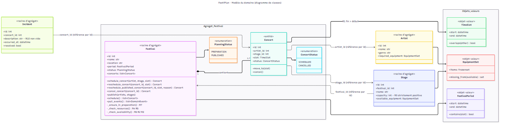

# Étape 2 — Modèle métier (DDD)

Code : `app/domain/`. Aucun import de FastAPI, Pydantic ou SQLAlchemy (vérifié par `tests/unit/test_architecture.py`).

## 1. Entités

Une entité a une identité stable : deux objets aux mêmes valeurs restent distincts.

| Entité | Fichier | Identité | Remarque |
|---|---|---|---|
| `Festival` | `festival.py` | `id` | Racine de l'agrégat Festival |
| `Concert` | `festival.py` | `id` | Deux concerts aux mêmes horaires sont deux concerts différents |
| `Artist` | `artist.py` | `id` | Porte ses besoins techniques |
| `Stage` | `stage.py` | `id` | Référence son festival par `festival_id` |
| `Incident` | `incident.py` | `id` | Référence un concert par `concert_id` |

## 2. Objets-valeurs

Immuables (`@dataclass(frozen=True)`), comparés par valeur, **valides dès leur création** : on ne peut pas
fabriquer un créneau invalide.

| Objet-valeur | Invariant garanti à la création | Comportement |
|---|---|---|
| `TimeSlot` (créneau) | R1 : `end > start` | `overlaps(other)` : deux créneaux qui se touchent ne se chevauchent pas |
| `FestivalPeriod` | fin du festival > début | `contains(slot)` (R6) |
| `EquipmentSet` | ensemble normalisé (sans doublon ni vide) | `missing_from(available)` (R5) |

Avant, ces notions étaient des `datetime` isolés et des chaînes `"a,b,c"` : la règle de chevauchement était dans
`utils/date_helpers.py` et le découpage de chaînes dans le service.

## 3. Agrégats et justification des frontières



```
┌──────────── Agrégat Festival ─────────────┐     ┌─ Agrégat Artist ─┐   ┌─ Agrégat Stage ─┐   ┌─ Agrégat Incident ─┐
│ Festival (racine)                          │     │ Artist           │   │ Stage           │   │ Incident           │
│  ├─ period : FestivalPeriod                │     │  required_equip. │   │  capacity > 0   │   │  description ≠ ""  │
│  ├─ status : PlanningStatus                │     └──────────────────┘   │  available_eq.  │   │  concert_id ───────┼──▶ Concert
│  └─ concerts : [Concert]                   │◀─ artist_id ──────────────  │  festival_id ───┼──▶ Festival            (par id)
│       └─ slot : TimeSlot, status           │◀─ stage_id ─────────────────└─────────────────┘
└────────────────────────────────────────────┘
```

**Pourquoi les concerts sont dans l'agrégat Festival ?** Les règles les plus importantes portent sur
*l'ensemble du planning* et non sur un concert isolé :

- R2 et R3 (chevauchements) comparent un concert à tous les autres concerts du festival ;
- R6 compare le créneau à la période du festival ;
- R7 dépend de l'état du planning (publié ou non) ;
- R8 revérifie tous les concerts au moment de la publication.

Si `Concert` était un agrégat séparé, aucune de ces règles ne pourrait être garantie par un seul objet :
il faudrait les disperser dans des services. En passant toujours par la racine `Festival`
(`schedule_concert`, `reschedule_concert`, `cancel_concert`, `publish`…), on a **un seul point d'entrée**
pour toute modification du planning, et une seule transaction (`FestivalRepository.save`).
Compromis accepté : on charge tous les concerts d'un festival pour en modifier un (quelques dizaines à
quelques centaines de lignes, ce qui reste raisonnable).

**Pourquoi Artist, Stage et Incident sont des agrégats séparés ?** Ils ont leur propre cycle de vie
(un artiste existe hors de tout festival, un incident est déclaré après coup) et leurs invariants sont
locaux (R9, R10). Ils sont référencés **par identifiant**, jamais par objet imbriqué.
Le cas d'utilisation les charge et les passe à `Festival` quand une règle en a besoin (R4, R5).

## 4. Invariants : où sont-ils garantis ?

| Règle | Garantie par | Test principal |
|---|---|---|
| R1 fin > début | Objet-valeur `TimeSlot.__post_init__` | `test_value_objects.py` |
| R2 pas de chevauchement sur une scène | Agrégat `Festival._check_availability` | `test_festival_aggregate.py` |
| R3 un artiste ne joue pas deux fois en même temps | Agrégat `Festival._check_availability` | idem |
| R4 références existantes, scène du festival | Cas d'utilisation (existence → `NotFound`) + `Festival._check_resources` (scène du festival) | `test_concert_use_cases.py`, `test_festival_aggregate.py` |
| R5 équipements | `EquipmentSet.missing_from` appelé par `Festival._check_resources` | `test_festival_aggregate.py` |
| R6 dans la période du festival | `FestivalPeriod.contains` appelé par `Festival._check_availability` | idem |
| R7 planning publié non modifiable | `Festival._ensure_in_preparation` + procédure `reschedule_published_concert` | idem + non-régression |
| R8 publication d'un planning valide | `Festival.publish` (revérifie R4, R5, R6, R2, R3 pour chaque concert) | `test_publish_refuses_inconsistent_planning` |
| R9 capacité > 0 | Entité `Stage.__post_init__` (+ Pydantic pour le format) | `test_entities.py` |
| R10 incident valide | Entité `Incident.__post_init__` (description) + cas d'utilisation (concert existant) | `test_entities.py`, `test_catalog_use_cases.py` |

Les **règles de disponibilité du planning** (R6, R2, R3) sont centralisées dans **une seule méthode**,
`Festival._check_availability`, utilisée par la programmation, le déplacement ordinaire, la procédure
de modification d'un planning publié et la publication.

## 5. États et transitions

```
Planning (Festival.status)                         Concert.status

  ┌─────────────┐   publish()      ┌───────────┐       ┌───────────┐  cancel()   ┌───────────┐
  │ PREPARATION │ ───────────────▶ │ PUBLISHED │       │ SCHEDULED │ ──────────▶ │ CANCELLED │
  └─────────────┘  si R8 respectée └───────────┘       └───────────┘             └───────────┘
   programmer ✔                      programmer ✘ (409)   déplacer ✔               déplacer ✘
   déplacer   ✔                      déplacer   ✘ (409)                            annuler  ✘
   annuler    ✔                      annuler    ✘ (409)
   publier    ✔                      publier    ✘ (409, déjà publié)
                                     reschedule_published_concert(motif) ✔
```

**Règle retenue pour le défaut 3 : procédure spécifique de modification.** Après publication, le
déplacement ordinaire est refusé. Un déplacement reste possible via une procédure explicite
(`reschedule_published_concert`) qui :
1. n'est autorisée que si le planning est publié ;
2. exige un **motif** non vide ;
3. applique **toutes** les règles de disponibilité ;
4. garde le planning publié et produit un événement contenant le motif (pour prévenir le public).

Nous avons écarté la « dépublication » : retirer un planning déjà annoncé au public n'a pas de sens métier
pour un simple changement d'horaire.

## 6. Commande, cas d'utilisation, événement, réaction

Exemple du déplacement d'un concert :

| Notion | Élément du code | Rôle |
|---|---|---|
| Commande | `RescheduleConcert(concert_id, start_time, end_time)` (`application/commands.py`) | Demande d'action, simple donnée |
| Cas d'utilisation | `RescheduleConcertUseCase.execute()` (`application/use_cases/concerts.py`) | Charge l'agrégat, délègue la décision, enregistre, déclenche les effets |
| Décision métier | `Festival.reschedule_concert()` | Applique R7, R6, R2, R3 |
| Événement | `ConcertRescheduled(festival_id, concert_id, previous_slot, new_slot, reason)` (`domain/events.py`) | Fait accompli, au passé |
| Réaction | `NotificationHandler.handle()` → port `Notifier` → `FakeEmailNotifier` | Effet secondaire, après l'enregistrement |

Événements existants : `ConcertRescheduled`, `ConcertCancelled`, `PlanningPublished`.
L'agrégat les accumule (`_events`) ; le cas d'utilisation les récupère avec `pull_events()` **après**
`save()`. Un refus métier ne produit donc jamais d'événement.
