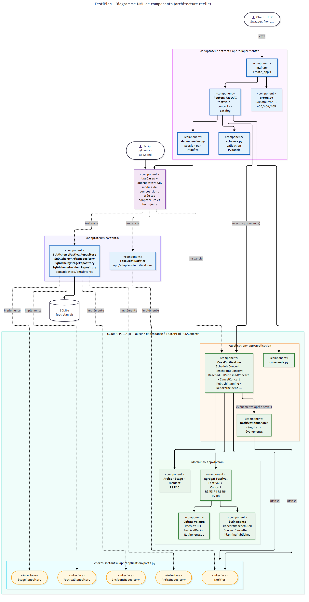
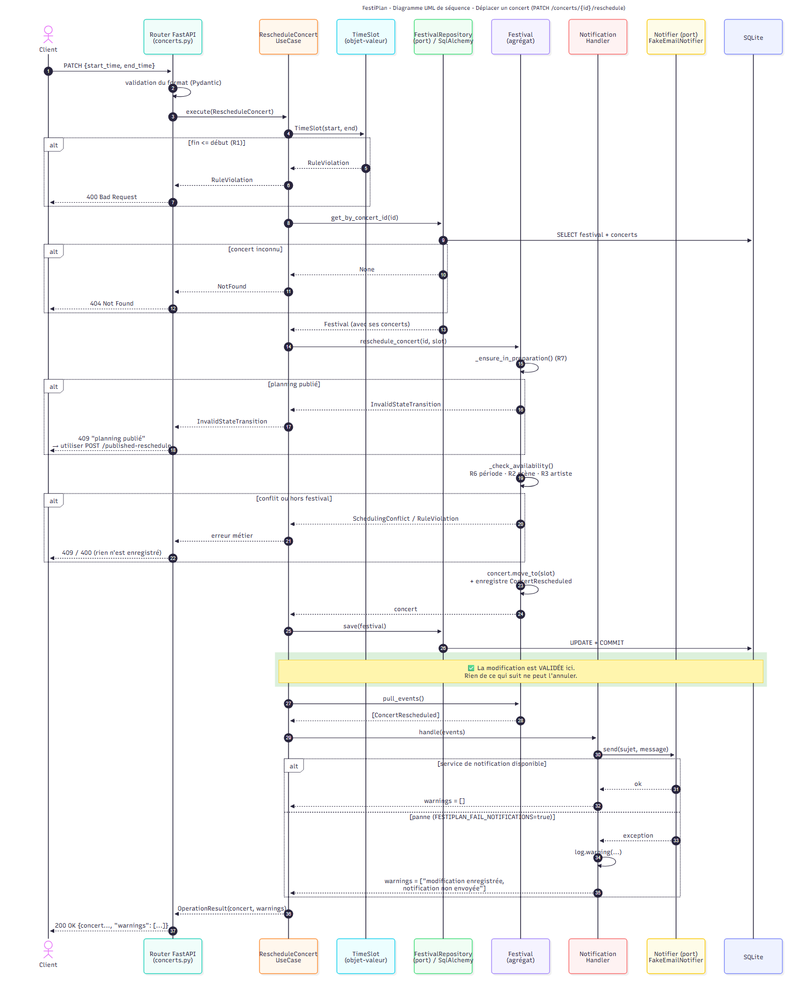

# Note d'architecture — Refactorisation de FestiPlan

Documents liés : [diagnostic initial](01-diagnostic.md) · [modèle du domaine](02-modele-domaine.md) ·
[diagramme de composants](diagrams/composants.png) · [diagramme de séquence](diagrams/sequence-deplacement.png) ·
[diagramme de classes du domaine](diagrams/classes-domaine.png)

## 1. Principaux défauts de l'architecture initiale

Détail et reproduction dans [01-diagnostic.md](01-diagnostic.md). En résumé :

1. **Aucun cœur métier indépendant** : les règles manipulaient des objets SQLAlchemy et vivaient dans des
   services qui recevaient une `Session`. Les tester demandait une base de données.
2. **Règles dispersées et incomplètes** : R1 dupliquée 3 fois, R2/R3/R6 vérifiées à la création mais pas au
   déplacement, R7 et R8 absentes, R9/R10 protégées uniquement par Pydantic.
3. **Responsabilités mélangées** : des contrôleurs faisaient du SQL et des règles métier ; des services
   instanciaient eux-mêmes leurs dépendances (repository, notification).
4. **Effet secondaire couplé à l'opération** : `commit()` puis notification dans la même méthode, la panne de
   notification remontant en erreur 500.
5. **Pas d'état métier explicite** : le statut du planning était une chaîne libre sans transitions contrôlées.

## 2. Organisation et responsabilités des couches

```
app/
├── domain/                 DOMAINE — Python pur
│   ├── value_objects.py    TimeSlot, FestivalPeriod, EquipmentSet
│   ├── festival.py         agrégat Festival (+ entité Concert, états du planning)
│   ├── artist.py  stage.py  incident.py
│   ├── events.py           événements de domaine
│   └── errors.py           erreurs métier (sans code HTTP)
├── application/            APPLICATION — cas d'utilisation
│   ├── ports.py            ports sortants (repositories, Notifier)
│   ├── commands.py         commandes (données d'entrée)
│   ├── notifications.py    réaction aux événements + OperationResult
│   └── use_cases/          festivals.py, concerts.py, catalog.py
├── adapters/               ADAPTATEURS — technologies
│   ├── http/               entrant : FastAPI (routers, schemas Pydantic, errors, dependencies)
│   ├── persistence/        sortant : SQLAlchemy (models, repositories, database)
│   └── notifications/      sortant : FakeEmailNotifier
├── bootstrap.py            COMPOSITION — création et injection des dépendances
├── main.py                 démarrage FastAPI
├── seed.py                 données de démo (passe par les cas d'utilisation)
└── config.py
```

| Couche | Responsabilité | Ne doit pas |
|---|---|---|
| Domaine | Concepts métier, invariants, transitions d'état, événements | Connaître HTTP, la base, les notifications |
| Application | Orchestrer : charger via les ports, déléguer la décision au domaine, enregistrer, déclencher les effets secondaires | Contenir des règles métier, instancier un adaptateur |
| Adaptateur HTTP | Valider le **format** (Pydantic), traduire requête → commande et résultat/erreur → réponse | Faire du SQL, décider d'une règle métier |
| Adaptateurs sortants | Implémenter les ports avec une technologie (SQLAlchemy, email) | Décider d'une règle métier |
| Composition | Choisir les implémentations concrètes et les injecter | — |

**Règle de dépendance** : les flèches vont toujours vers le centre (`adapters → application → domain`).
Elle est vérifiée automatiquement par `tests/unit/test_architecture.py`, qui échoue si un fichier du domaine
ou de l'application importe `fastapi`, `sqlalchemy`, `pydantic` ou `app.adapters`.

Exemple : le contrôleur de déplacement fait désormais 3 lignes utiles
(`app/adapters/http/routers/concerts.py`) : construire la commande, appeler `execute`, formater la réponse.

### Diagramme de composants



## 3. Ports et adaptateurs

| Port (contrat, `application/ports.py`) | Adaptateur (implémentation) | Utilité |
|---|---|---|
| `FestivalRepository` | `SqlAlchemyFestivalRepository` | Charger / enregistrer l'agrégat Festival **complet** (festival + concerts) en une transaction |
| `ArtistRepository` | `SqlAlchemyArtistRepository` | Artistes ; conversion `"a,b"` ↔ `EquipmentSet` |
| `StageRepository` | `SqlAlchemyStageRepository` | Scènes ; idem |
| `IncidentRepository` | `SqlAlchemyIncidentRepository` | Incidents |
| `Notifier` | `FakeEmailNotifier` (`fail=True` simule une panne) | Envoi des notifications |
| *(port entrant)* cas d'utilisation `execute(commande)` | Routers FastAPI, script `seed.py` | Points d'entrée de l'application |

Les tests utilisent d'autres adaptateurs pour les mêmes ports (`tests/fakes.py` : repositories en mémoire,
`SpyNotifier`, `FailingNotifier`). C'est la démonstration concrète de l'intérêt des ports.

**Assemblage des dépendances** : `app/bootstrap.py` est le seul endroit qui crée les repositories SQLAlchemy et
le notifier, et les injecte dans les cas d'utilisation (classe `UseCases`). FastAPI y accède par
`dependencies.get_use_cases` (une session par requête) ; le script `seed.py` l'utilise aussi, sans HTTP.

## 4. Modèle du domaine retenu

Détail dans [02-modele-domaine.md](02-modele-domaine.md).

- **Entités** : `Festival`, `Concert`, `Artist`, `Stage`, `Incident`.
- **Objets-valeurs** : `TimeSlot` (R1), `FestivalPeriod` (R6), `EquipmentSet` (R5).
- **Agrégats** : `Festival` (racine) contient ses `Concert` car R2, R3, R6, R7, R8 portent sur tout le
  planning ; `Artist`, `Stage`, `Incident` sont des agrégats séparés, référencés par identifiant.
- **Invariants** : chaque règle R1–R10 a un emplacement unique (tableau au §4 du document de modèle).
  Les règles de disponibilité (R2, R3, R6) sont centralisées dans `Festival._check_availability`.
- **Événements** : `ConcertRescheduled`, `ConcertCancelled`, `PlanningPublished`.

Validation : **Pydantic** vérifie le format (types, longueurs, `capacity > 0` pour une réponse 422 claire),
**le domaine** garantit les règles. R9 est donc vérifiée deux fois, volontairement : Pydantic pour l'API,
`Stage` pour tous les autres chemins (seed, script, tests).

## 5. Correction des trois défauts

Le diagramme de séquence ci-dessous montre le déplacement d'un concert : les refus métier (400, 404, 409),
le moment où la modification est validée (`save()`), puis le traitement de la notification et de son échec.



### Défaut 1 — Chevauchement de concerts
- **Cause** : `reschedule_concert` ne rappelait pas `_check_conflicts`.
- **Correction** : toutes les opérations sur le planning passent par l'agrégat `Festival`, qui appelle la même
  méthode `_check_availability` (R6 période, R2 scène, R3 artiste) pour programmer, déplacer, modifier un
  planning publié et publier. Le concert déplacé est ignoré dans la comparaison (il peut chevaucher son
  ancien créneau). Un conflit lève `SchedulingConflict` → **HTTP 409**, rien n'est enregistré.
- **Tests** : `test_defect1_*` (API) + `test_reschedule_refuses_*` et `test_valid_reschedule_*` (domaine)
  + `test_conflicting_reschedule_is_neither_saved_nor_notified` (cas d'utilisation).

### Défaut 2 — Échec de notification après modification
- **Décision** : la notification est un **effet secondaire** ; son échec ne doit ni annuler ni masquer la
  réussite de l'opération métier.
- **Correction** :
  1. l'agrégat enregistre un événement (`ConcertRescheduled`) ;
  2. le cas d'utilisation fait `save()` → **la modification est validée** ;
  3. il transmet ensuite les événements au `NotificationHandler`, qui appelle le port `Notifier` ;
  4. une exception du notifier est **capturée et journalisée** (`logging.warning`), puis renvoyée comme
     avertissement.
- **Comportement HTTP** : **200** avec le concert modifié et un champ `warnings` :
  `["La modification est enregistrée, mais la notification n'a pas pu être envoyée (...)"]`.
  Le client sait que l'opération a réussi et que la notification est à relancer. Même chose pour la publication.
- **Pourquoi pas plus ?** Une file de messages / « outbox » avec renvoi automatique serait plus robuste, mais
  disproportionnée pour ce projet (voir limites).
- **Tests** : `test_defect2_*` (API, via `FESTIPLAN_FAIL_NOTIFICATIONS`) et
  `test_notification_failure_does_not_cancel_the_reschedule` (cas d'utilisation avec `FailingNotifier`).

### Défaut 3 — Modification d'un planning publié
- **Décision** : *procédure spécifique de modification* (pas de dépublication : un planning annoncé au public
  le reste).
- **Correction** : état explicite `PlanningStatus` (`PREPARATION` → `PUBLISHED`).
  - `publish()` n'est possible qu'en préparation et seulement si tous les concerts respectent les règles
    (R8, sinon 409 avec la liste `problems`).
  - En état `PUBLISHED`, les opérations ordinaires (programmer, déplacer, annuler) lèvent
    `InvalidStateTransition` → **409**.
  - Nouvelle procédure `POST /concerts/{id}/published-reschedule` avec un **motif obligatoire** : réservée aux
    plannings publiés, applique toutes les règles, garde le planning publié et transmet le motif dans
    l'événement et la notification.
- **Tests** : `test_defect3_*` (API), `test_ordinary_operations_are_refused_once_published`,
  `test_published_planning_can_be_changed_with_explicit_procedure`, `test_publish_refuses_inconsistent_planning`.

### Codes HTTP (traduction centralisée dans `adapters/http/errors.py`)

| Erreur du domaine | Code | Exemple |
|---|---|---|
| Format invalide (Pydantic) | 422 | `capacity: 0`, nom non textuel |
| `RuleViolation` | 400 | fin avant début, hors festival, équipement manquant, description vide |
| `NotFound` | 404 | concert, festival, artiste ou scène inconnu |
| `SchedulingConflict` | 409 | scène occupée, artiste déjà programmé |
| `InvalidStateTransition` | 409 | planning publié, déjà publié, concert annulé |

## 6. Stratégie de tests

```
tests/
├── unit/domain/          34 tests  objets-valeurs, entités, agrégat (R1–R10, transitions)   ~0,1 s
├── unit/application/     21 tests  cas d'utilisation avec repositories en mémoire           ~0,1 s
├── unit/test_architecture.py  24   règle de dépendance (aucun import technique dans le cœur)
├── integration/          19 tests  routes HTTP (TestClient) + repositories SQLAlchemy (SQLite mémoire)
├── non_regression/       10 tests  les 3 défauts, par l'API (échouaient avant : 9 failed / 1 passed)
├── fakes.py              doubles de test des ports
└── conftest.py           base SQLite en mémoire neuve par test, injectée via dependency_overrides
```

- Les tests **du domaine et des cas d'utilisation** ne démarrent ni FastAPI ni SQLite (les imports techniques
  ne sont faits que dans les fixtures d'intégration).
- Les tests **applicatifs** vérifient les décisions et les interactions avec les ports : « rien n'est enregistré
  ni notifié en cas de conflit », « enregistré puis notifié », « enregistré malgré la panne ».
- Les tests **d'adaptateurs** vérifient le câblage réel : codes HTTP, sérialisation, aller-retour en base.
- Les tests **de non-régression** passent uniquement par l'API, comme un utilisateur ; ils ont été écrits avant
  la refactorisation et sont restés inchangés depuis.
- Les 6 tests d'origine sont conservés dans `tests/integration/test_http_api.py`.

Total : **108 tests**, exécutés en ~5 s avec `pytest`.

## 7. Démarche suivie (refactorisation progressive)

1. Écriture des tests de non-régression des 3 défauts sur le code initial → 9 échecs (preuve).
2. Création du domaine (objets-valeurs, agrégat) + tests unitaires, sans toucher à l'API.
3. Création des ports, commandes et cas d'utilisation + tests avec doubles en mémoire.
4. Création des adaptateurs SQLAlchemy et du notifier, puis du module de composition.
5. Remplacement des contrôleurs FastAPI pour appeler les cas d'utilisation (mêmes URL, même schéma de base).
6. Exécution de toute la suite (non-régression comprise), puis suppression de l'ancien code
   (`api/`, `services/`, `repositories/`, `utils/`, `models.py`, `schemas.py`, `database.py`).

## 8. Limites restantes et compromis

- **Notification non rejouée** : en cas d'échec, elle est journalisée et signalée, mais pas renvoyée
  automatiquement. Amélioration possible : table « outbox » des événements + tâche de renvoi.
- **Transaction par repository** : `save()` fait le `commit`. C'est suffisant car chaque cas d'utilisation
  modifie un seul agrégat ; un *Unit of Work* serait utile si une opération devait en modifier plusieurs.
- **Chargement complet du planning** pour modifier un concert : simple et sûr pour un festival (quelques
  centaines de concerts), à revoir pour de gros volumes.
- **Concurrence** : deux déplacements simultanés pourraient passer les contrôles chacun de leur côté.
  Un verrou optimiste (numéro de version sur le festival) corrigerait ce cas.
- **R3 limitée à un festival** : un artiste programmé au même moment dans deux festivals différents n'est
  pas détecté.
- **Procédure « planning publié »** limitée au déplacement : l'annulation d'un concert publié suivrait le même
  modèle (`cancel_published_concert` avec motif) mais n'a pas été ajoutée.
- **Motif non persisté** : il est transmis dans l'événement et la notification, pas historisé en base.
- **Dates sans fuseau horaire** (comme le projet initial) ; pas de migrations Alembic (schéma de tables
  inchangé, créé par `create_all`).
- **Changements visibles de l'API** : codes plus précis (409 pour les conflits, 404 pour les références
  inconnues au lieu de 400), champ `warnings` ajouté aux réponses de modification, nouvelles routes
  `GET /festivals/{id}` et `POST /concerts/{id}/published-reschedule`. `GET /concerts?festival_id=` renvoie
  404 si le festival n'existe pas (liste vide auparavant).
